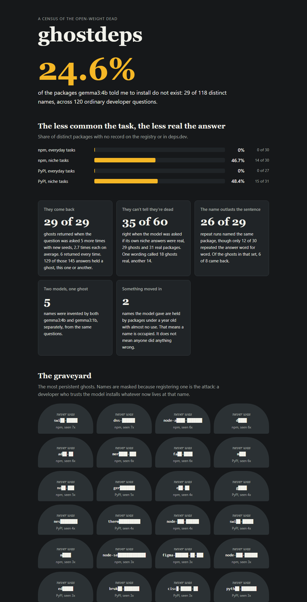

# ghostdeps

Ask a local AI model which package to use and it will give you a confident answer,
install command included. For common tasks that answer is usually fine. For unusual
ones, the package often doesn't exist.

I wanted to know how often that happens, so I asked Gemma 535 questions on my laptop
and checked every package it named against npm and PyPI. This repo is the code
behind that census. It also includes a small tool you can point at a `package.json`,
a requirements file or a pasted chatbot answer to check the names before you install
anything.



## What I found

Everything ran locally on a laptop with a 4 GB GPU, in about 70 minutes of model
time. I call a name a "ghost" when the model told me to install it but neither the
registry nor [deps.dev](https://deps.dev) has any record of it.

| | gemma3:4b | gemma3:1b |
|---|---|---|
| Everyday tasks | **0 of 57** names are ghosts | 3 of 58 |
| Niche tasks | **29 of 61** (47.5%) | 30 of 58 (51.7%) |
| Overall | 29 of 118 (24.6%) | 33 of 116 (28.4%) |

Both sources confirmed all 29 gemma3:4b ghosts from that sweep, and each one was
reviewed individually.

The same names keep coming back. I asked each question that produced a ghost five
more times, with new seeds at temperature 0.7. All 29 ghosts returned at least once,
2.7 times each on average, and 6 returned every time. 129 of those 145 answers
contained a ghost, either the same one or a different one, for 63 distinct ghosts in
all. These 29 were already the model's first choice, so some repetition is expected.

The model can't spot its own mistakes. I showed it its own niche answers, 29 ghosts
and 31 real packages, and asked whether each one was real. It got 35 of 60 right
under each of two wordings. One wording called 18 ghosts real, the other called 14,
and 10 of the 60 names flipped between them.

The package name is steadier than the rest of the answer. When I repeated 30
questions, only 12 answers matched word for word. But 29 of the originals named a
package, and 26 of those named the same one again. Ghosts held on a little less
well: 6 of the 8 in that set came back.

Two of the names are already taken. Both belong to new packages with almost no use,
and one was first uploaded 12 days after I pulled the weights. That one looks like a
vendor's ordinary alias. I'm not naming either of them, because sitting on one of
these names doesn't mean anyone did anything wrong.

## Why it matters

There's a name for attacking this: slopsquatting. You find a name that models keep
inventing, register it, and wait for someone to paste the install command.
[Spracklen et al.](https://arxiv.org/abs/2406.10279) measured package hallucinations
across 16 models, and I repeated two of their tests, repetition and self-detection,
on a model they didn't cover.

## Try it

You'll need Node 20 or newer. `check` needs nothing else, but `summon` and `census`
also need [Ollama](https://ollama.com) with `gemma3:4b`.

```bash
git clone https://github.com/imarpanpatra/ghostdeps
cd ghostdeps

node src/cli.js check package.json requirements.txt
node src/cli.js check answer.md              # or pipe in a pasted answer
node src/cli.js summon "parse Apple Wallet .pkpass files" --eco npm
```

`check` exits with 0 when everything is clean, 1 when it finds trouble, and 2 when it
couldn't find out, for example if a registry was unreachable, a file couldn't be
read, or there was nothing to check. I kept 2 separate so CI never mistakes "npm was
down" for "your dependencies are fine".

It reads `package.json` and requirements files under any name, follows `-r` includes,
and copes with the UTF-16 that PowerShell writes. In pasted answers it recognises
npm, pip, yarn, pnpm, bun, poetry, uv, pipenv, pipx and pdm commands, along with
`npx`-style runners and `npm create`. It doesn't read `pyproject.toml`, lockfiles or
`Pipfile`, so those give exit 2. `conda` installs come from a different registry, so
it skips them.

Exit 0 is a stronger result on a manifest than on a pasted answer. On a manifest,
every dependency was checked. On a pasted answer, every name it found is real, but
it may have missed a command it didn't recognise, and it prints a note saying so. If
you have a manifest, check that instead.

| State | Meaning |
|---|---|
| `alive` | Real, and not suspiciously new |
| `GHOST` | No such name on the registry, and deps.dev has no memory of it |
| `POSSESSED` | Under a year old and barely used, or a census ghost that exists now |
| `dead` | Real, but deprecated by its maintainer |
| `tombstone` | Existed, then was removed or fully yanked |
| `EXORCISED` | npm replaced it with a security holding package |
| `unknown` | The registry gave no usable answer, so nothing is proven |

`check` never asks the model. I didn't want the verdict to depend on the thing that
caused the problem.

## What I left out

The raw ghost names aren't in this repo. `data/runs.jsonl` and `data/registry.json`
are gitignored, the report masks at least two thirds of every name, and
`data/ghosts.json` only holds SHA-256 hashes. That lets `check` recognise a census
ghost without publishing a list of names worth registering. `test/leak.test.js`
fails if a full name ends up in a published file. Spracklen et al. withheld their
list too.

This won't stop anyone determined. The weights are open and the task list is right
here, so someone could regenerate most of it in an afternoon. I just don't want to
save them the afternoon. I haven't registered any of these names, and please don't
either, even as a joke, because that's the attack.

## Reproducing it

```bash
node src/cli.js census sweep          # 120 questions, about 20 minutes
node src/cli.js census resolve        # ask the registries
node src/cli.js census determinism    # repeat every fourth question
node src/cli.js census haunt          # new seeds for each haunted question
node src/cli.js census resolve
node src/cli.js census mirror         # "is this real?"
node src/cli.js census mirror-valid   # the same, in the paper's wording
node src/cli.js census sweep --model gemma3:1b
node src/cli.js census resolve
node src/cli.js analyze
node src/cli.js report
```

Every answer is written to disk as it arrives, so you can stop a run and resume it.
`node src/cli.js watch` asks the registries about your local ghosts again and exits 1
if one has been claimed.

Your numbers should be close to mine but won't match exactly. The next section
explains why.

## What this doesn't show

- This is one model family on one task list: 120 hand-written tasks, half of them
  deliberately obscure, written before the first census run. I left out the eight
  tasks from my first probe. The task mix drives the rates, so be careful comparing
  them with other studies.
- It says nothing about closed models, because I didn't test any. Spracklen et al.
  found open-source models hallucinated more than commercial ones (21.7% against
  5.2%).
- A ghost means no trace was found. A deletion that neither source recorded would
  look the same, so I can't prove a name never existed.
- A ghost isn't always a pure invention. At least one looks like a real project that
  just isn't on PyPI. The install still fails and the name is still free.
- Not every ghost can be registered, since npm refuses names too close to existing
  ones. I didn't test which, because the only test is registering them.
- Temperature 0 wasn't fully repeatable. To save time, the census hangs up as soon
  as the install command appears. Replaying 30 questions on an idle machine gave 12
  identical answers with that early stop and 26 without it, so aborting one answer
  changes the ones after it. I don't know what caused the last 4. I kept the early
  stop because 26 of the 29 repeats that named a package named the same one.
- The self-awareness result is small: 60 names and two wordings.
- `check` only knows the public registries. A private `@company/x` package shows up
  as a ghost, because the public registry has never heard of it.

## Tests

```bash
npm run check     # 179 tests, no network or model needed
npm run mutants   # breaks 148 guards one at a time and confirms a test catches each
```

The first mutation run caught 6 of my own mistakes: 2 guards that did nothing and 4
tests that passed for the wrong reason. Four rounds of code review then found a lot
more in `check` itself, and the parser was rebuilt around those findings. A few rare
forms still slip through: `npm in`, `python -mpip`, a misspelled verb, and a pip flag
that takes a value before the verb.

There are no runtime dependencies, which felt right for a project about bad ones.

## Licence

MIT
